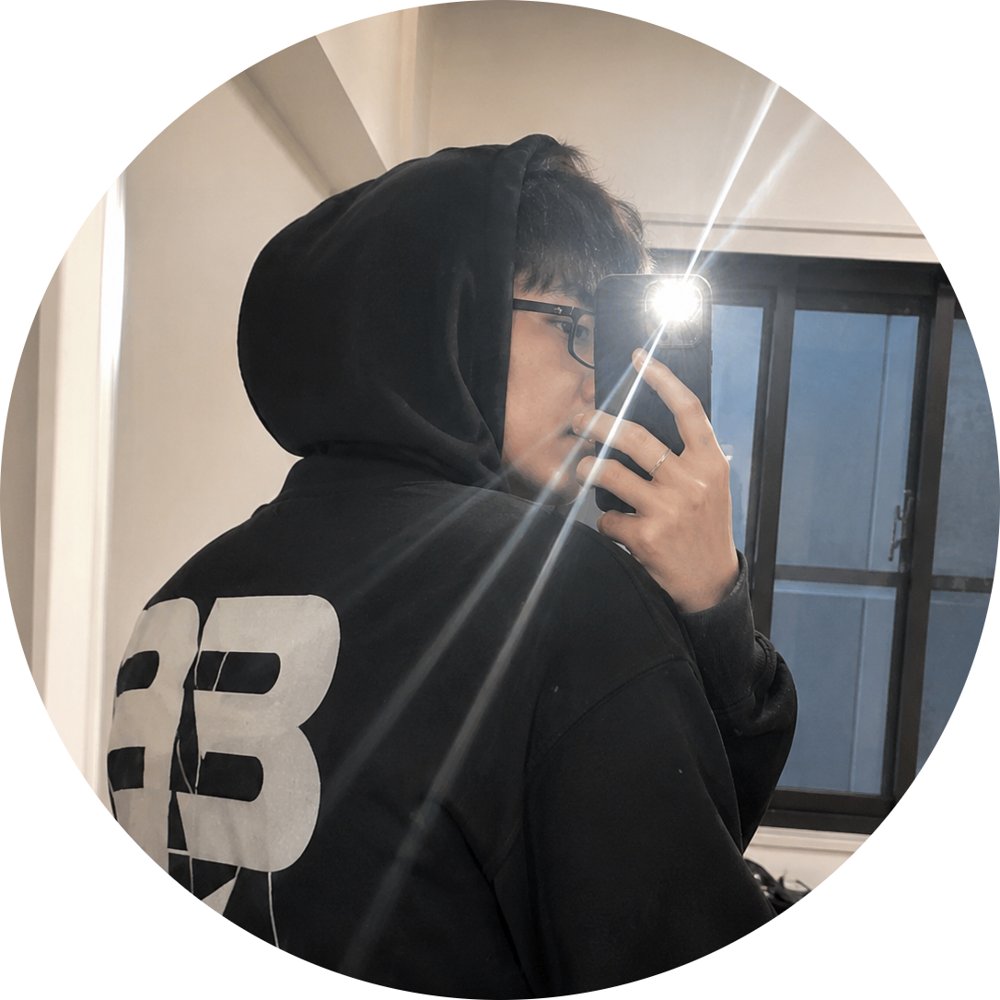

  

 

 
 <b>Learning &amp; Building</b>
&nbsp;&nbsp;·&nbsp;&nbsp;
 <b>System Development</b>
&nbsp;&nbsp;·&nbsp;&nbsp;
 <b>Malang, Indonesia</b>
  

##  Tech Stack

**Languages** 
   

**Frameworks &amp; Runtime** 
   

**Database &amp; ORM** 
  

**Tools &amp; Platforms** 
   

##  GitHub Stats

##  Contribution Graph

## Contact

  

